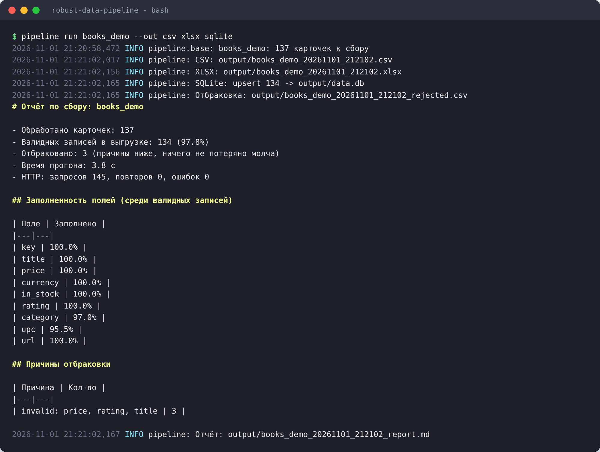
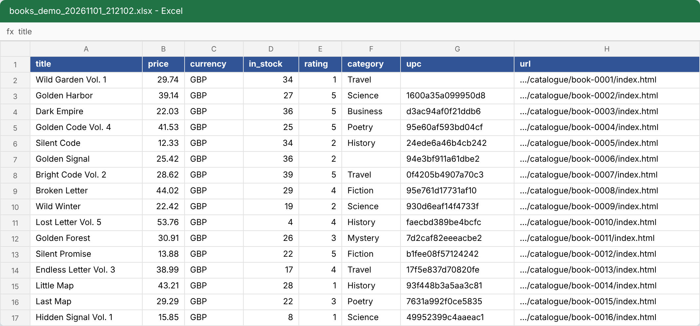
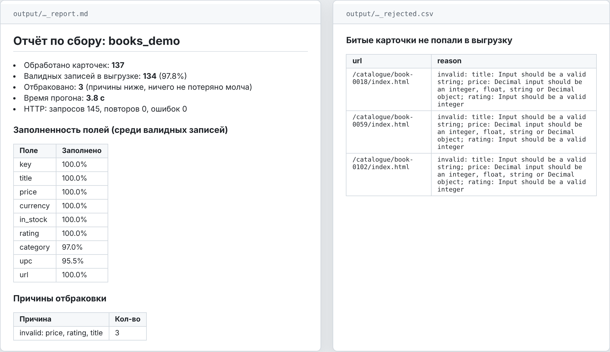

# robust-data-pipeline

Мой шаблон для заказов на парсинг. Собирает данные с сайта, проверяет каждую строку и отдаёт результат в CSV, Excel, SQLite/Postgres или Google Sheets. После каждого прогона пишет отчёт: сколько собрано, сколько отбраковано и почему.

Сделал, чтобы под новый сайт не писать всё с нуля: копирую демо-источник, меняю селекторы и модель, остальное (ретраи, лимиты, выгрузка, отчёт) уже работает.



## Что получает заказчик

Таблицу с данными. Служебные поля в конце, шапка с фильтром:



И отчёт с отбраковкой. Если на сайте попалась кривая карточка (нет названия, цена «по запросу»), она не попадёт в выгрузку молча, а уйдёт в отдельный файл с причиной:



> Скрины сняты с реального прогона по демо-каталогу на 137 карточек (3 специально битые), поднятому локально. Против настоящего books.toscrape.com запускается так же, без `BOOKS_BASE_URL`.

## Как устроено

```
list_urls()  ->  parse_list()  ->  parse_item()  ->  pydantic-модель  ->  выгрузка + отчёт
 пагинация       ссылки на          сырые поля        валидна? в данные
                 карточки                             нет? в rejected.csv
```

- **httpx (async)** + семафор на число одновременных запросов + лимит запросов в секунду, чтобы не словить бан.
- **tenacity**: повторы с экспоненциальной паузой на 429, 5xx и таймауты. 404 не повторяется.
- Пагинация идёт до первого 404 или пустой страницы. Если 3 страницы списка подряд не грузятся, сайт считается лежащим и прогон останавливается.
- **selectolax (lexbor)** для HTML: в разы быстрее BeautifulSoup.
- **pydantic**: обязательные поля без значения по умолчанию. Нет поля - строка в отбраковку.
- **upsert по `key`** в SQLite/Postgres: повторный прогон обновляет цены, а не плодит дубли.

## Запуск

```bash
pip install -e ".[dev]"
cp .env.example .env

pipeline list
pipeline run books_demo --limit 50 --out csv xlsx
pipeline schedule books_demo --cron "0 */6 * * *" --out sqlite
```

С Postgres и по расписанию:

```bash
docker compose up -d --build
```

Все настройки (параллельность, лимит, прокси, БД, Google Sheets) лежат в `.env`, см. `.env.example`.

## Новый сайт

Пошагово в [docs/adding-a-source.md](docs/adding-a-source.md). Обычно 30-60 минут до первых 50 строк.

## Тесты

```bash
ruff check . && pytest -q
```

Тесты гоняются на сохранённых HTML из `tests/fixtures`, в сеть не ходят. Проверяется парсинг, отбраковка битых карточек, ретраи на 503, остановка при лежащем сайте, upsert без дублей и цифры в отчёте. В CI то же самое на Python 3.11-3.13 плюс сборка Docker.

## Ограничения

- Сайты, которые рендерят всё на JS, требуют Playwright (`pip install .[browser]`). Сначала всегда смотрю вкладку Network: часто там есть JSON и браузер не нужен.
- Капчи не обхожу.
- Персональные данные людей не собираю. Если у сайта есть API, беру данные из API.
